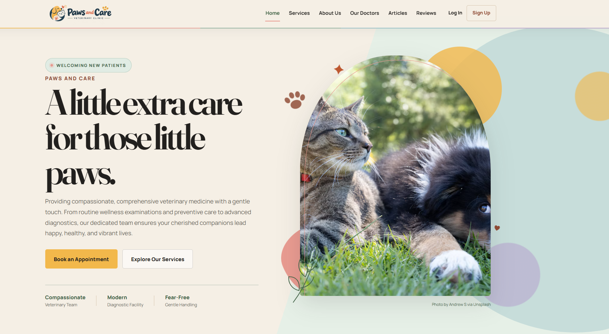
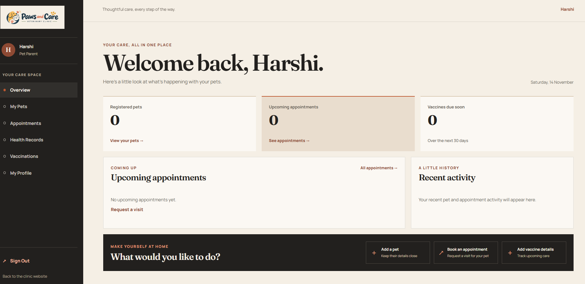
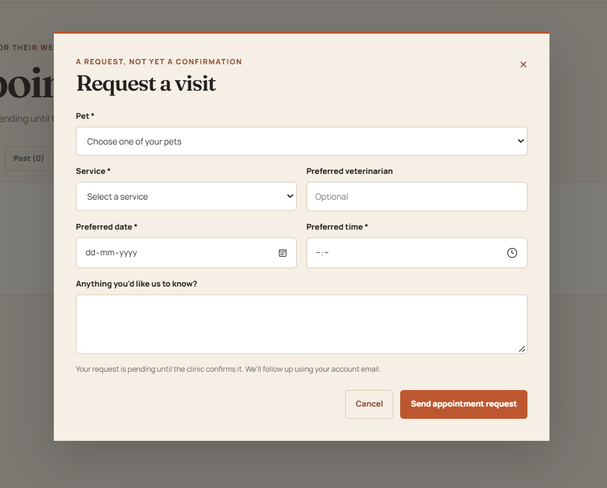

# Paws and Care — Veterinary Clinic Website

A modern, responsive veterinary clinic website designed to help pet owners explore veterinary services and manage their pets' information.

**Live Website:** https://paws-and-care-five.vercel.app

## Features

### Public Website
- Responsive homepage and navigation
- Veterinary services and doctor profiles
- Pet care articles and customer reviews
- User registration and login

### Pet Parent Dashboard
- Secure user authentication and account management
- Add, view, edit and manage multiple pet profiles
- Submit and track appointment requests
- View pet health records
- Track vaccination information
- Manage personal profile details

## Tech Stack

| Technology | Purpose |
|---|---|
| React.js | Frontend UI |
| JavaScript | Application logic |
| CSS | Styling and responsive design |
| Vite | Development server and build tool |
| Supabase Auth | Authentication and user management |
| PostgreSQL | Database |
| Supabase | Backend services |
| Vercel | Deployment and hosting |
| Git & GitHub | Version control and source code hosting |

## Project Architecture

- **Frontend:** React application built with Vite.
- **Backend services:** Supabase provides authentication and database services.
- **Database:** PostgreSQL stores user profiles, pets, appointments, health records and vaccination information.
- **Hosting:** Vercel hosts the deployed application.

## Run Locally

### 1. Clone the repository

```bash
git clone https://github.com/Harshita-Negi16/paws-and-care.git
```

### 2. Navigate to the project folder

```bash
cd paws-care
```

### 3. Install dependencies

```bash
npm install
```

### 4. Configure environment variables

Create a `.env.local` file in the project root:

```env
VITE_SUPABASE_URL=your_supabase_project_url
VITE_SUPABASE_PUBLISHABLE_KEY=your_supabase_publishable_key
```

Use your own Supabase project credentials. Never commit `.env.local` or secret keys to GitHub.

### 5. Start the development server

```bash
npm run dev
```

Open the local URL shown in your terminal.

### 6. Build for production

```bash
npm run build
```

## Security

- Supabase handles user authentication.
- Row Level Security (RLS) policies protect user-specific database records.
- Environment variables are used for project configuration.
- Private credentials should never be committed to the repository.

## Future Improvements

- Clinic admin dashboard
- Appointment confirmation and management by clinic staff
- Automated vaccination reminders
- Improved pet medical record management
- Additional accessibility and mobile usability improvements

## Developer

Built as a full-stack web development project using React and Supabase.

---

**Paws and Care — A little extra care for those little paws. **
## Screenshots

### Homepage


### Dashboard


### Appointments

